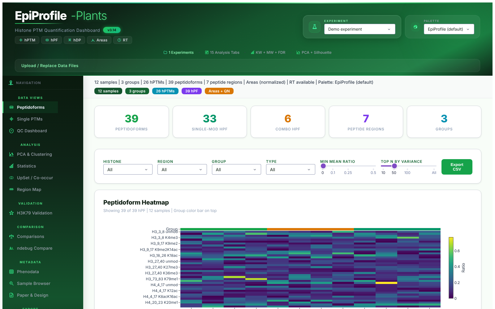

# EpiProfile-Plants Dashboard

Interactive, publication-quality visualization dashboard for **EpiProfile-Plants** histone PTM quantification output. Built with Dash 4.0 and Plotly 6.0.


---

## Overview

EpiProfile-Plants Dashboard provides **17 interconnected analysis modules** for exploring histone post-translational modification (PTM) data from mass spectrometry experiments. It correctly handles the three-level hierarchical structure of EpiProfile output and provides non-parametric statistics, PCA, biclustering, co-occurrence analysis, and R-ready data export -- all from a web browser with no programming required.

> See [WHITEPAPER.md](WHITEPAPER.md) for the full technical documentation.



---

## Data Hierarchy

The dashboard classifies EpiProfile output into three biological levels:

| Level | Name | Description | Source |
|-------|------|-------------|--------|
| **hDP** | Derivatized Peptide | Peptide region headers (e.g., `TKQTAR(H3_3_8)`) | `histone_ratios.xls` headers |
| **hPF** | Peptidoform | Combinatorial modifications (e.g., `H3_9_17 K9me2K14ac`) | `histone_ratios.xls` data rows |
| **hPTM** | Individual PTM | Single marks (e.g., `H3K4me1`) | `histone_ratios_single_PTMs.xls` |
| **Areas** | MS1 Intensities | Raw peak areas, log2 + quantile normalized | `histone_ratios.xls` area block |
| **RT** | Retention Time | Chromatographic retention times (minutes) | `histone_ratios.xls` RT block |

---

## 17 Analysis Tabs

| Tab | Key Features |
|-----|-------------|
| **Peptidoforms (hPF)** | Clustered heatmap, 6 interactive filters, violin plots, editable DataTable |
| **Single PTMs (hPTM)** | Z-score heatmap, grouped bars, violin/box plots |
| **QC Dashboard** | Missingness, completeness, area distributions, before/after QN, PSM evidence, Dinosaur MS1 features, region-detail coverage |
| **PCA & Clustering** | 2D/3D PCA, biplots, scree, dendrogram, correlation, biclustering, K-Means |
| **Statistics** | Kruskal-Wallis + BH-FDR + epsilon-squared, volcano, enrichment, data source selector |
| **UpSet / Co-occurrence** | Detection patterns, Jaccard index, log2 odds ratio, mutual exclusivity |
| **Region Map** | Mean ratios at derivatized peptide level, sequence coverage, PTM landscape, charge-state detail per region |
| **H3K79 Validation** | Target-mark evidence for the H3 73-83 region: ratios, areas, RT, PSMs |
| **Comparisons** | Mann-Whitney U, Welch t or moderated t (limma-style); imputation and batch correction (median centering, ComBat); Cliff's delta, Hedges' g; volcano, FC bars, MA plots |
| **Phenodata** | Sample metadata viewer |
| **Sample Browser** | PDF chromatograms, per-sample profiles |
| **Paper & Design** | Publication metadata and experimental design for the loaded dataset |
| **Export to R** | Filtered data + R script bundle (ZIP) |
| **ndebug Compare** | Detection efficacy comparison between ndebug modes |
| **Cross-Experiment** | Shared hPTMs across loaded experiments: overlap, z-scored group means, correlation |
| **Tools & Report** | Dinosaur MS1 features, Annotator (mzML / ms1 / ms2 spectra, ProForma fragment annotation, MGF export), PTMVision CSV, HTML report |
| **Analysis Log** | SQLite-backed audit trail |

---

## Quick Start

```bash
# Clone
git clone https://github.com/biopelayo/epiprofile-dashboard.git
cd epiprofile-dashboard

# Install dependencies
pip install -r requirements.txt

# Run with the bundled demo dataset (no configuration needed)
python epiprofile_dashboard.py

# Or with your own EpiProfile output directory
python epiprofile_dashboard.py /path/to/epiprofile/output

# Multiple experiments, optionally with explicit names
python epiprofile_dashboard.py "PXD046788 ndebug_0=/data/PXD046788/RawData" /data/other_exp

# Custom port / host
python epiprofile_dashboard.py /path/to/output --port 8080 --host 0.0.0.0
```

Open **http://localhost:8050** in your browser.

### Configuring experiments

For a fixed set of experiments, copy `experiments.example.json` to `experiments.json`
next to the script and edit the paths. The file is read automatically when the
dashboard is launched without directories; a different location can be given with
`--config PATH` or the `EPIPROFILE_CONFIG` environment variable.

```json
{
  "PXD046788 ndebug_0": {
    "dir": "/data/PXD046788/RawData",
    "ratios": "histone_ratios.xls",
    "singleptm_dir": "histone_layouts",
    "phenodata": "/data/PXD046788/phenodata.tsv"
  },
  "Other experiment": "/data/other"
}
```

Only `dir` is required. Relative paths are resolved against the config file.
`ndebug` and `dataset` are inferred from the experiment name, directory and
ratios filename (`ndebug_0`, `ndebug2`, `ndeg2`, `PXD######`) unless given
explicitly; experiments that share a dataset but differ in ndebug mode become
available in the **ndebug Compare** tab.

Environment variables: `EPIPROFILE_CONFIG`, `EPIPROFILE_PORT`, `EPIPROFILE_HOST`.
Pass `--no-demo` to fail instead of falling back to the demo dataset.

---

## Key Features

### Normalization Pipeline
Raw MS1 areas undergo: **zeros to NaN** (non-detects) -> **log2 transform** -> **quantile normalization** (Bolstad 2003). This corrects systematic run-to-run biases while preserving non-detected features as NaN.

### Non-parametric Statistics
- **Kruskal-Wallis H-test** for multi-group comparisons
- **Mann-Whitney U test** for pairwise comparisons
- **Benjamini-Hochberg FDR** correction
- Log-scale aware fold-change computation

### Interactive Analysis
- Switch between **ratios** (compositional) and **areas** (absolute) as data source
- 12 ggsci-inspired color palettes
- Experiment selector with live upload support
- Design filters for complex experiments
- CSV/TSV/R-bundle export with user-defined filters

### Biclustering
Spectral biclustering (Kluger 2003) simultaneously clusters features and samples, with cluster boundary visualization and group color annotations.

### Co-occurrence Analysis
Jaccard similarity + log2 odds ratio matrices reveal PTM pairs that co-occur or are mutually exclusive, with hierarchical clustering visualization.

---

## Supported Experiments

The dashboard is dataset-agnostic: any EpiProfile-Plants output directory can be
loaded. A small synthetic demo (`examples/demo_experiment`, 12 samples, 3 groups,
7 peptide regions, per-sample PSM and region-detail files, Dinosaur features, a mini mzML and .ms2) is bundled and loads when nothing else is configured. It can be
regenerated with `python scripts/make_demo_data.py`.

`experiments.example.json` lists the *Arabidopsis thaliana* experiments the
dashboard was developed against (ndebug_0 / ndebug_2 variants of PXD046788,
PXD014739, PXD046034 and an ontogeny series). The **Paper & Design** tab shows
curated publication metadata for these PRIDE accessions when the experiment name
or path contains the accession.

New experiments can also be uploaded directly via the web interface (Replace or New mode). Uploads accept TSV, CSV, `.xlsx` and EpiProfile's tab-separated `.xls`.

---

## Input File Formats

EpiProfile-Plants generates `.xls` files that are actually **tab-separated** (TSV, MATLAB convention):

| File | Content |
|------|---------|
| `histone_ratios.xls` | Three blocks: Ratios, Areas, RT (separated by unnamed columns) |
| `histone_ratios_single_PTMs.xls` | 45 individual PTM marks |
| `phenodata*.tsv` | Sample metadata (`Sample_Name`, `Sample_Group`, optional `Tissue`, `Design`, `Batch`). Aliases `Sample`/`Group`/`Condition` are accepted. |
| `histone_layouts/` | Per-sample PDFs, detail files, PSMs |

---

## Directory Structure

```
epiprofile-dashboard/
|-- epiprofile_dashboard.py    # Main application (Dash layout + callbacks)
|-- ep_stats.py                # Imputation, batch correction (ComBat), moderated t, effect sizes
|-- ep_io.py                   # Region detail files, PSMs, Dinosaur, mzML/ms1/ms2, annotator, PTMVision
|-- ep_tools.py                # Dinosaur / Annotator installers and runners
|-- ep_report.py               # Self-contained HTML report
|-- requirements-optional.txt  # pyteomics, psims, rustyms
|-- experiments.example.json   # Experiment configuration template
|-- examples/demo_experiment/  # Synthetic demo dataset
|-- scripts/make_demo_data.py  # Demo dataset generator
|-- tests/                     # Smoke tests (every tab) + module unit tests
|-- assets/sidebar.css
|-- WHITEPAPER.md              # Technical white paper
|-- CHANGELOG.md
|-- requirements.txt
|-- README.md
```

### External tools and optional dependencies

```bash
pip install -r requirements-optional.txt   # pyteomics + psims (mzML), rustyms (annotation cross-check)
python ep_tools.py install                 # downloads Dinosaur (Java 8+) into tools/
python ep_tools.py run sample.mzML         # MS1 feature detection -> sample.features.tsv
python ep_tools.py annotator               # locate / launch the Annotator desktop app
```

| Tool | What the dashboard does with it |
|------|--------------------------------|
| [Dinosaur](https://github.com/fickludd/dinosaur) | Runs it on the experiment's mzML files from **Tools & Report**; loads `*.features.tsv` into the QC Dashboard. |
| [Annotator](https://github.com/snijderlab/annotator) / [rustyms](https://github.com/snijderlab/rustyms) | Built-in spectrum viewer for mzML and `.ms1`/`.ms2`, offline b/y ladder annotation of ProForma peptidoforms, rustyms cross-check, MGF export and launch of the desktop app (`tools/annotator*` or `ANNOTATOR_BIN`). |
| [PTMVision](https://ptmvision-tuevis.cs.uni-tuebingen.de/) | Exports a site-level CSV (UniProt accession, position, Unimod name/id) ready for upload. |
| [PTMViz](https://pubmed.ncbi.nlm.nih.gov/34039258/) | Consumes EpiProfile output directly; export the ratios CSV from **Export to R**. |

Run the tests with:

```bash
pip install pytest
python -m pytest -q tests
```

---

## Requirements

- **Python** 3.10+
- **Memory** ~200 MB per loaded experiment
- **Browser** Chrome, Firefox, or Edge

---

## Version History

| Version | Highlights |
|---------|-----------|
| v3.15 | Tools & Report (Dinosaur, Annotator, PTMVision, HTML report), Cross-Experiment, ComBat / moderated t / effect sizes, region detail and PSM evidence |
| v3.14 | Portable JSON configuration, CLI name inference, bundled demo dataset, smoke tests |
| v3.13 | Sidebar navigation panel, compact header |
| v3.12 | Paper & Design tab |
| v3.11 | H3K79 Validation tab, tissue filter, SVG icons |
| v3.10 | 7 experiments with ndebug variants, ndebug Compare tab |
| v3.9 | PCA ellipses, silhouette analysis, Region Map with sequence context |
| v3.8 | Biclustering fix, co-occurrence analysis, web upload, dark theme header |
| v3.7 | Statistics bug fixes, Export to R tab |
| v3.6 | Areas as primary data source, log2+QN normalization |
| v3.5 | SQLite logging, biclustering, adaptive sizing, 3-slot upload |
| v3.4 | 12 ggsci color palettes, enriched phenodata |
| v3.3 | Green theme, upload support, 5th experiment |
| v3.2 | Region Map, Phenodata tab, faceted violins |
| v3.1 | hDP/hPF/hPTM hierarchy, PCA biplots, UpSet, statistics |

---

## Citation

If you use this dashboard in your research, please cite:

```
EpiProfile-Plants Dashboard v3.15
https://github.com/biopelayo/epiprofile-dashboard
```

---

## What is EpiProfile-Plants?

[EpiProfile](https://github.com/zfyuan/EpiProfile2.0) is a MATLAB-based tool for quantifying histone post-translational modifications from mass spectrometry data. The `-Plants` variant is optimized for plant histones (H3.1, H3.3 variants). This dashboard provides interactive visualization and statistical analysis that goes beyond the static MATLAB PDFs.

---

## License

MIT
